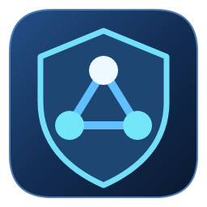
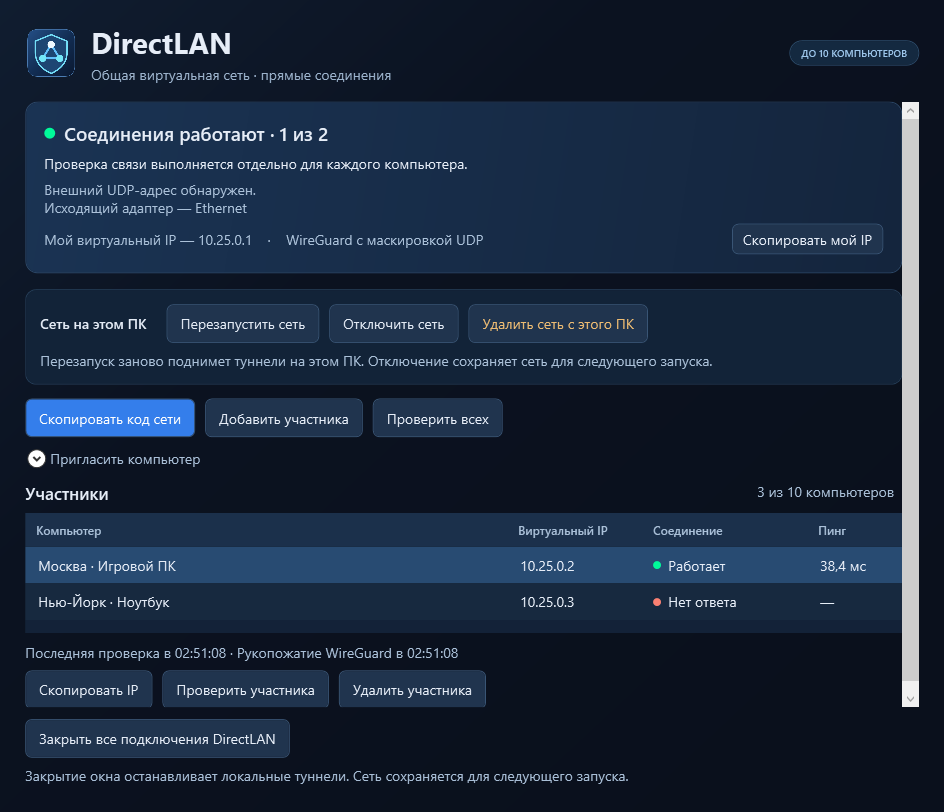

# DirectLAN

До 10 Windows-ПК в общей виртуальной IPv4-сети с прямыми каналами WireGuard. Владелец подтверждает участников и распространяет подписанный состав сети.

**[Скачать Windows x64](https://github.com/Yorodoshi/DirectLAN/releases/download/v0.3.5/DirectLAN-0.3.5-win-x64.zip)** · **[Инструкция](docs/QUICKSTART.md)** · **[Защита и ограничения](docs/SECURITY.md)**

Распакуйте архив полностью и запустите DirectLAN-Start.exe. .NET runtime и подписанный Wintun включены.

## Возможности

- Прямые соединения между участниками и отдельный пинг для каждого ПК.
- Приглашения и допуск, подписанные владельцем сети.
- Автоматическая передача подписанного допуска и обновлений состава по защищённому служебному UDP-каналу; копирование кода остаётся резервным способом.
- WireGuard и индивидуальные дополнительные ключи каналов.
- Необязательная оболочка XChaCha20-Poly1305 со случайным дополнением пакетов.
- Перезапуск, отключение и возобновление локальных соединений с сохранением профиля.
- Автоматический выбор IP, UDP-порта и физического адаптера.
- Иконка приложения и анимация состояния подключения с учётом настроек анимации Windows.

Для подключения обменяйтесь приглашением и запросом участника. После принятия запроса владельцем DirectLAN автоматически передаёт подписанный допуск. Оставьте программу открытой на обоих ПК и используйте версию 0.3.5. Состояние ожидания допуска ещё не означает проблему NAT.

Некоторые схемы NAT, включая CGNAT, и фильтрация UDP препятствуют прямому соединению и автоматической доставке допуска. Резервный обмен кодом обновляет состав сети, но не устраняет недоступность прямого пути. Ретранслятор в основной режим не включён, поэтому соединение между любыми двумя сетями не гарантируется. [Инструкция и проверка связи](docs/QUICKSTART.md).

## Сборка

Нужны Windows x64, Go 1.27.3 и .NET SDK 10.0.300. Запустите scripts/build.ps1. Скрипт проверяет зависимости, тесты, go vet, собирает WPF и проверяет подпись Wintun. Результат сохраняется в bin.

Векторная иконка хранится в ui/DirectLAN/Assets/DirectLANMark.xaml. Для пересоздания PNG и ICO используйте scripts/build-icon.ps1. Флаг -LauncherResource также пересобирает ресурс Go-запускателя через закреплённую версию утилиты rsrc для Go.

Прежний режим двух ПК с кодами DL2 доступен через «Открыть прежнюю пару». Новая сеть использует коды DL3 и отдельный профиль. Исходники старого режима с HTTPS-координатором также сохранены.

Лицензии и уведомления зависимостей включены в каталог licenses готовой сборки.
